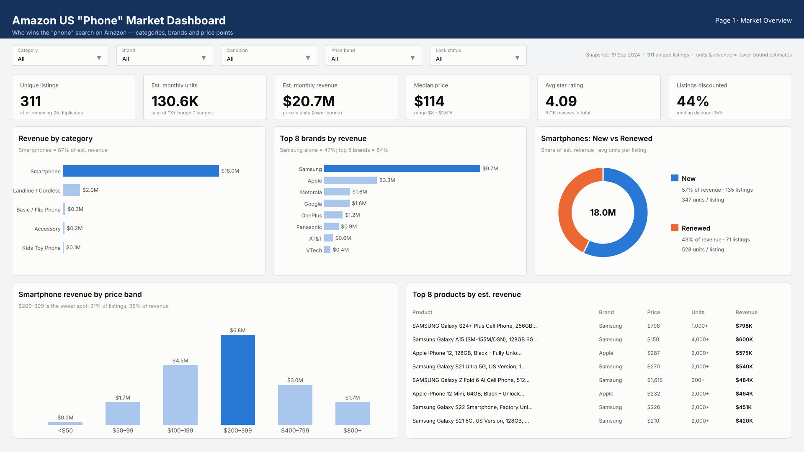
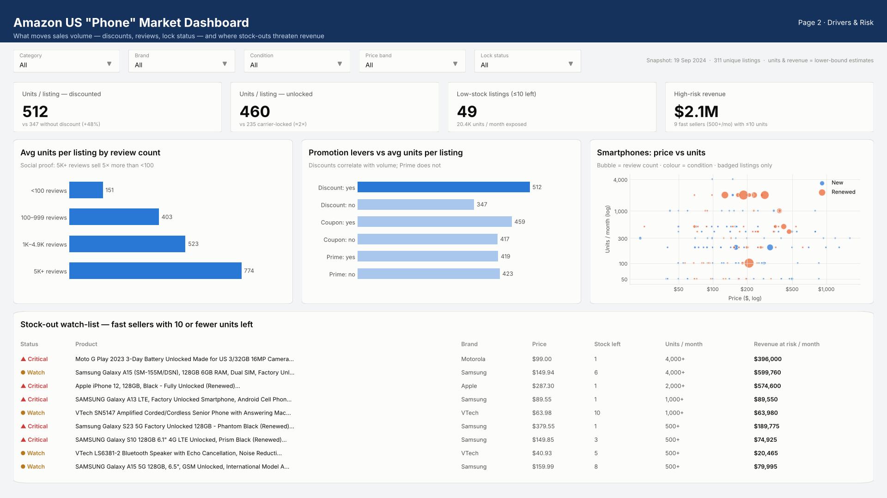

Phone Market Data Analysis Project

Project Overview

An end-to-end data analysis project focused on preparing, cleaning, validating, and analyzing mobile phone market data to support business insights and reporting.

Tools & Technologies

- Python: Data processing, cleaning, and exploratory data analysis.
- SQL: Database preparation, validation, and business queries.
- Power BI: Data modeling, DAX measures, and dashboard design.
- Excel: Data documentation and quality tracking.

Project Workflow

1. Import and examine raw phone market data.
2. Clean and transform datasets using Python.
3. Identify and document data quality issues.
4. Prepare SQL scripts for data loading and validation.
5. Define analytical measures using DAX.
6. Develop dashboard designs for reporting and analysis.

Dashboard Previews

Market Overview

Drivers & Risk Analysis

Project Files

The repository includes Python scripts, SQL queries, Jupyter notebooks, data quality logs, Power Query transformations, DAX measures, and dashboard mockups.

Author

Amr Ali

Data Analysis Portfolio Project
